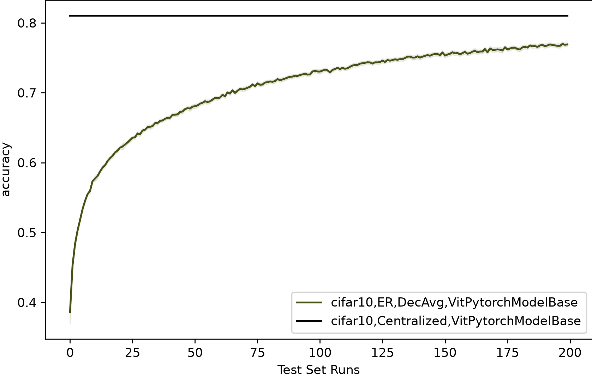

# Experiments



The plot compares centralized training, FedAvg, and DecAvg on two topologies (Barabási–Albert and Erdős–Rényi), all using the `Compact Convolutional Transformers` model on IID Cifar10. To reproduce it, run:

```bash
PYTHON_GIL=0 python main.py \
    --seed 123 \
    --output_directory logs/ \
    --num_parallel_clients 50 \
    --concurrent_runs 4 \
    --experiment_name_filter ".*(ER|Centralized).*"
```

To plot the results, use the *Comparison plot* in the [notebooks repository](https://github.com/DecentralizedLearning/notebooks).

## Good to know

### Runtime
The full run takes about **2h 45m on a single NVIDIA A100** (2:44:29 measured).

### Faster cuDNN
For a speed-up, enable cuDNN autotuning and turn off deterministic kernels. Runs will no longer be bit-for-bit reproducible.

```bash
TORCH_CUDNN_BENCHMARK=True TORCH_CUDNN_DETERMINISTIC=False \
PYTHON_GIL=0 python main.py ...
```

### Recommended dataset config
Augmentations are applied on the fly, so the dataset cache must be turned off:

```json
"dataset.train.arguments.use_cache": false,
"dataset.train.arguments.augmentations": true
```

### DataLoader tuning
Augmentations are CPU-heavy and can bottleneck training. Adjust these settings to your machine: raise `num_workers` if the GPU sits idle, and lower it if you run out of CPU or RAM, especially with `--concurrent_runs` > 1.

```json
"client.training_engine.arguments.training_DataLoader_kwargs": {
    "persistent_workers": true,
    "num_workers": 2,
    "prefetch_factor": 3
}
```
